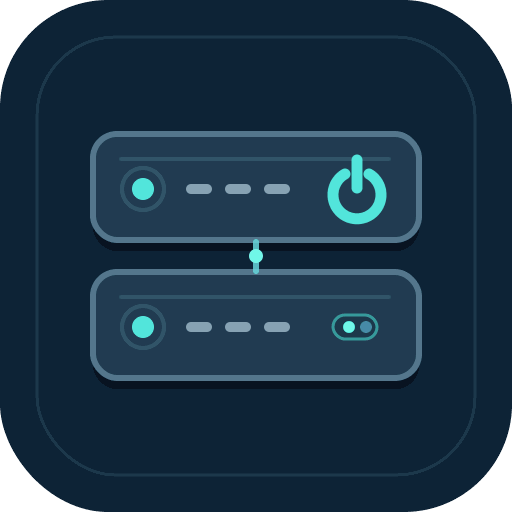

<div align="center">
  

  # IPMI Core

  **Security-focused IPMI power management and hardware monitoring for Home Assistant, with verified power states, guarded controls and graceful ACPI shutdown.**

  <sub>Published by <strong>Arcotangana</strong> · Maintained by <a href="https://github.com/coriumalpha">@coriumalpha</a> · v0.1.7</sub>

  
  
  [](LICENSE)

  [Installation](#installation) · [Controls](#controls-and-safety) · [Telemetry](#hardware-telemetry) · [Architecture](#architecture) · [Security](#security) · [Development](#development)
</div>

IPMI Core is a custom Home Assistant integration that talks directly to a server's Baseboard Management Controller (BMC). It exposes a physically verified chassis power binary sensor, guarded power-on and **ACPI graceful-shutdown** buttons, BMC communication diagnostics and read-only hardware readings.

It intentionally does **not** expose hard power-off, reset, power-cycle, raw IPMI commands, an HTTP bridge or an unattended shutdown scheduler.

## Compatibility and scope

- **Tested:** Home Assistant 2026.9.1, IPMI 2.0 / RMCP+, and a compatible BMC with Operator-level access.
- **Dependency:** `pyghmi==1.6.19` (installed by Home Assistant).
- **Installation model:** Home Assistant Container and other installations supporting custom integrations; no Supervisor add-on is required.
- **Hardware support:** BMC capabilities vary by manufacturer and firmware. Read-only SDR metrics appear only when the controller supplies supported, valid data. Broader vendor coverage is not established.
- **Version:** 0.1.7. There is no claim of an official HACS catalog listing, formal security audit or universal hardware compatibility.

## Features

| Entity | What it means |
| --- | --- |
| Chassis power (binary sensor) | **On** or **Off** only after a successful BMC state read; **Unavailable** on communication failure. |
| Power on (button) | Checks physical state before requesting ON; skips commands if already on. Verifies the transition with bounded, read-only polls. |
| Request graceful shutdown (ACPI) (button) | Asks the operating system to shut down; confirms physical OFF. **Never** falls back to a hard power cut. |
| BMC communication (diagnostic binary sensor) | Whether the **latest chassis-state request** succeeded. Not a continuous network ping. |
| Hardware warnings (diagnostic binary sensor) | Aggregates BMC-reported sensor warnings when telemetry is available. |
| Numeric SDR sensors | Dynamically discovered temperature, fan RPM, voltage, current and power metrics where supported. |

Power status and telemetry are **separate polling paths**. Power status defaults to 60 seconds (configurable 30–300 seconds); telemetry refreshes every 180 seconds. A missing or unreadable measurement is unavailable rather than an invented zero.

## Installation

### HACS — recommended

Install and update IPMI Core through HACS directly from this public repository, without copying integration files through SSH or manually unpacking a ZIP:

1. Open **HACS → ⋮ → Custom repositories**.
2. Enter `https://github.com/coriumalpha/ha-ipmi-core`, select **Integration**, and click **Add**.
3. Open **IPMI Core** in HACS and select **Download**. With no GitHub Release yet, use the default branch (`main`).
4. Restart Home Assistant so the new integration is loaded.
5. Open **Settings → Devices & services → Add integration → IPMI Core**.
6. Provide a descriptive device name, the BMC hostname/IP, UDP port (default **623**), dedicated **Operator** credentials and polling interval (default **60 seconds**).
7. Verify that the physical chassis power sensor matches the real server state **before** pressing a power button.

Future integration updates will be managed by HACS. A restart of Home Assistant may still be needed after downloading an updated version.

### Manual fallback

1. Copy `custom_components/ipmi_core/` from this repository into `<config>/custom_components/ipmi_core/`, including `brand/`.
2. Restart Home Assistant and configure **IPMI Core** under **Settings → Devices & services**.
3. Check the actual chassis state before enabling controls.

> **Network requirements:** Allow Home Assistant to reach the BMC on UDP/623. Keep the BMC on a restricted management network; do not expose IPMI to the public Internet.

The CI workflow also generates a manual-installation ZIP. Adding the URL as a **custom repository** in HACS does not mean IPMI Core is accepted into HACS's default catalog. A public repository is required by HACS for this installation route.

## Controls and safety

**Power on:** the worker reads the real BMC power state immediately before acting. If already ON, it does not resend an ON command. Otherwise it requests ON once and checks the actual state every 3 seconds for up to 35 seconds. A button press or accepted request is **not** itself proof of physical power.

**Graceful shutdown:** pressing the ACPI button verifies the chassis is ON, sends one OS-managed shutdown request and checks for physical OFF every 10 seconds for up to five minutes. A timeout, unsupported ACPI implementation or unreachable BMC **never** triggers hard-off, reset or cycle. Duplicate operations and conflicting transitions are guarded by serialized operations and cooldowns.

Both buttons are enabled by default for newly registered integrations. Older entity-registry preferences may remain in effect; inspect them in **Settings → Devices & services → IPMI Core → Entities**.

**Before requesting ACPI shutdown:** confirm the operating system processes ACPI correctly, and that workloads, guests and backup jobs can stop safely. IPMI Core cannot determine the safety of stopping applications or virtual machines. For unattended workflows, do not treat BMC power state as evidence that scheduled work has finished.

## Hardware telemetry

The integration reads supported numeric SDR data using a short-lived, deadline-bounded worker. Sensor names come from the BMC; the integration does not require a fixed vendor- or host-specific sensor list.

Supported units: **°C**, **RPM**, **V**, **A** and **W**. Where appropriate, Home Assistant uses temperature, voltage, current and power device classes with measurement state classes. The BMC's health flags are available as each metric's `bmc_health` attribute. An aggregate hardware-warning binary sensor reports affected sensor names.

Telemetry discovery can occur after Home Assistant has started with the chassis OFF. Absent readings become unavailable on a subsequent telemetry refresh. **Because chassis state and telemetry refresh separately, recently powered-off devices may temporarily display previously sampled values.** See [Telemetry](docs/TELEMETRY.md) and [Sensor roadmap](docs/SENSORS.md).

## Architecture

```text
Home Assistant
  ├─ IPMI power coordinator  ──► verified chassis ON / OFF / unavailable
  ├─ Manual power buttons    ──► guarded ON / ACPI graceful shutdown
  ├─ Telemetry coordinator   ──► numeric SDR sensors / hardware warnings
  └─ bounded IPMI worker     ──► BMC (IPMI 2.0 / UDP 623)
```

Each operation runs `pyghmi` in a short-lived local child process. Input credentials are delivered through **stdin**, not process arguments. The child has a 12-second execution deadline and is terminated and reaped if it blocks. Operations for a configured BMC share a serialized execution path.

Read/write actions are explicitly allowlisted: `status`, guarded `power_on`, `graceful_shutdown` and read-only `telemetry`. There is no generic command execution interface.

## Security

- Use a **dedicated Operator-level BMC account** where supported. Protect Home Assistant's configuration storage and backups, which hold the account credentials.
- Segment the BMC management interface from untrusted networks and keep BMC firmware maintained.
- IPMI 2.0 / RMCP+ security depends on firmware and negotiated cipher suites. This project does not independently certify those settings.
- Controlling Home Assistant or having privileged BMC access can bypass the integration's button restrictions; the allowlist is not a host security boundary.
- Errors report sanitized failures; do not attach credential-bearing logs, BMC packets, serial numbers or asset identifiers to public bug reports.
- Use `unavailable` as an **unknown** state: never equate it with physically OFF.

See [Security policy](SECURITY.md).

## Limitations and roadmap

- Not an OS management agent, VM orchestrator or backup-job scheduler.
- No unconditional or automatic shutdown decisions are built into the integration.
- Telemetry updates can lag chassis transitions; a future improvement is to invalidate stale readings and schedule a fresh SDR update on verified ON/OFF transitions.
- Hardware and vendor-specific SDR availability varies; no manufacturer compatibility matrix has yet been established.
- There is no forced power-off or reset action, by design.
- A rare transient IPMI worker failure remains an item for future diagnostic hardening.

See [Automation guidance](docs/AUTOMATION.md), [Sensor roadmap](docs/SENSORS.md) and [Changelog](CHANGELOG.md).

## Development

```bash
python3 -m unittest discover -s tests -v
python3 -m compileall -q custom_components/ipmi_core tests
```

The offline tests use mocked IPMI responses, not live hardware. Validate any control change against a test BMC in a maintenance window before enabling automation. Contributions and vulnerability reports are described in [CONTRIBUTING.md](CONTRIBUTING.md) and [SECURITY.md](SECURITY.md).

Distributed under [AGPL-3.0](LICENSE).
